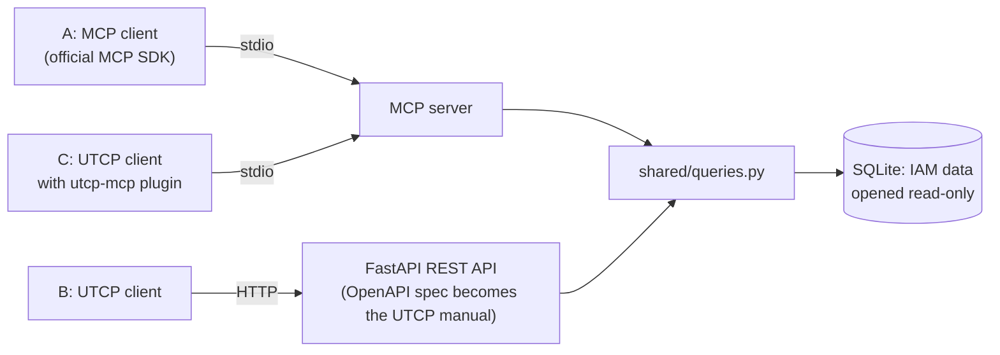

# MCP vs UTCP: a controlled benchmark on identical SQL tools

This project measures how two AI tool-calling protocols compare when everything else is held constant: the **Model Context Protocol (MCP)** and the **Universal Tool Calling Protocol (UTCP)**.

The same three read-only SQL tools, running on the same Mock identity and access management (IAM) database, are called three different ways. Only the protocol path changes, so any difference in the results comes from the protocol layer, not from different code or data.

## Key findings

Measured on a Windows laptop on 21 Nov 2026: 3 runs × 3 paths × 3 tools × 200 timed calls, for **5,400 timed calls** in total. Each cell shows **median / p95 latency per call in milliseconds**, averaged over the 3 runs.

| Tool (rows returned) | A: MCP | B: UTCP direct | C: UTCP bridge |
|---|---|---|---|
| `find_identity` (10) | 5.3 / 6.8 | **3.1 / 4.1** | 7.1 / 9.0 |
| `get_entitlements` (11) | 5.5 / 6.8 | **3.1 / 3.9** | 7.3 / 8.4 |
| `find_orphaned_accounts` (120) | 9.6 / 12.6 | **3.4 / 4.1** | 11.7 / 14.6 |

1. **UTCP direct was the fastest path for every tool.** It was about 1.7× faster than MCP on small results and about 2.8× faster on the 120-row result.
2. **MCP's overhead grows with response size; UTCP's barely moves.** Going from 10 to 120 rows added about 0.3 ms to UTCP direct but about 4.3 ms to MCP. The benchmark records each MCP response's size, number of text blocks, and whether it also carries a structured copy of the same data, to test whether MCP sends each result more than once.
3. **The utcp-mcp bridge works, but costs about 2 ms per call** on top of plain MCP. That's the price of reusing existing MCP servers through a UTCP client.
4. **The results are stable.** Each path's median varied by less than 1 ms across runs, and p95 stayed close to the median.

**Cold start.** MCP and the bridge took about 1 second to start, because each launches a new MCP server process. UTCP direct took about 6 ms, but only because the REST API was already running, so those two numbers are not comparable.

**What it means in practice.** These differences are milliseconds per call, while an AI model's reply usually takes hundreds of milliseconds to several seconds. For an assistant making a few tool calls, the protocol barely matters for speed. It matters at volume: an access review that checks 1,000 users with one call each would take about 5.5 s over MCP and about 3.1 s over UTCP direct.

Every run also records response size in bytes and tool description size (the text an AI agent reads for each tool). These appear in `results/history.xlsx`.

## How it works



- **Path A, MCP:** the baseline. An MCP client launches the MCP server and calls its tools over stdio.
- **Path B, UTCP direct:** a UTCP client reads FastAPI's auto-generated OpenAPI spec, turns it into tools with no hand-written manual, and calls the REST endpoints directly. There is no wrapper server.
- **Path C, UTCP bridge:** a UTCP client uses the `utcp-mcp` plugin to call the same MCP server as Path A. This shows one client using both kinds of tools.

All three paths end at the same functions in `shared/queries.py`.

## What is measured

| Metric | How |
|---|---|
| Correctness | Before timing, every path must return identical data for every tool, or the benchmark stops |
| Latency | 200 timed calls per tool per path after a warm-up call; median and p95 |
| Cold start | Time from creating the client to the first successful result |
| Response size | REST response body vs. MCP result message, in bytes |
| Tool description size | Name, description, and input schema of each path's tools, in bytes |
| Environment | Python and library versions, saved with every run |

## How the test is kept fair

- **Same code and data for every path.** All three use the same `queries.py` and the same SQLite database, opened in read-only mode.
- **Same tool descriptions.** The MCP tools and REST endpoints use word-for-word identical docstrings.
- **Same answers before any timing.** The correctness check confirms all paths return identical data.
- **Same quiet logging.** Access logs and library INFO logs are switched off for every path. This was a real problem found during testing: the `utcp-mcp` library printed several log lines per call, including the full result, which inflated Path C's timings until logging was disabled.
- **No path favoured by order.** There are 3 full runs, and the order of paths is shuffled in each.
- **No one-time costs in the timings.** Plugin loading happens before the timed runs.
- **Same address.** Everything uses `127.0.0.1`, which avoids name-lookup delays on Windows.

## Getting started

Requirements: Python 3.10 or newer. Tested on Windows with VS Code.

1. Clone the repository and open the folder in VS Code.
2. In the VS Code terminal, create the environment and install the packages:
   ```
   python -m venv .venv
   .venv\Scripts\python -m pip install -r requirements.txt
   ```
3. Press **Ctrl+Shift+P**, run **Python: Select Interpreter**, and choose `.venv`.
4. Press **Ctrl+Shift+P**, run **Tasks: Run Task**, and choose:
   - **0. Check setup** to confirm everything is in place
   - **5. Run everything (one click)**, which creates the database, starts the API, runs the benchmark, saves the results, and stops the API

Other tasks: **1. Seed database**, **2. Start REST API (Path B)**, **3. Run benchmark** (needs the API running), and **4. Run interop demo (Path C)**.

Without VS Code, run `.venv\Scripts\python -m run_all` from the project folder. On macOS or Linux, use `.venv/bin/python -m run_all` (untested).

## Results files

| File | What happens on each run |
|---|---|
| `results/bench_results.csv` | Replaced with the latest run: timings, sizes, correctness, and versions |
| `results/history.xlsx` | The new run is added; old runs are never deleted |

`history.xlsx` has three sheets:
- **Charts:** latest-run latency, latest-run response size, and the trend across all runs
- **Summary:** one line per run, path, and tool, averaged with formulas
- **History:** every measurement from every run

Close `history.xlsx` before running the benchmark, because Windows locks open Excel files. If a save ever fails, that run stays in the CSV and is added to the history automatically at the start of the next run.

## Project structure

```
mcp-vs-utcp-bench/
├── .vscode/            tasks (0-5), debug configs, interpreter setting
├── bench/
│   ├── run_bench.py    the benchmark: checks, timing, CSV and Excel history
│   ├── extras.py       correctness, response sizes, tool description sizes, versions
│   └── history.py      keeps results/history.xlsx (Charts, Summary, History)
├── data/
│   └── seed_synthetic_iam.py   builds the synthetic IAM database
├── path_a_mcp/
│   └── mcp_server.py   Path A: MCP server (FastMCP, stdio)
├── path_b_utcp/
│   └── api.py          Path B: FastAPI REST API
├── path_c_bridge/
│   └── demo_both.py    one UTCP client calling REST and MCP tools
├── shared/
│   ├── queries.py      the only SQL in the project (read-only)
│   └── utcp_templates.py   UTCP call templates for Paths B and C
├── results/            bench_results.csv and history.xlsx
├── check_setup.py      setup check with clear fixes
├── run_all.py          one-click runner
└── requirements.txt
```

## Limitations

- **Transport differs as well as protocol.** MCP runs over stdio here and UTCP over HTTP, so the comparison measures protocol and transport together.
- **One machine, one setup.** Everything ran on a single Windows laptop on localhost. Results may differ on other hardware or across a network.
- **No AI model in the loop.** The benchmark measures the tool-calling layer, not whether an agent gives better answers.
- **Cold start is not comparable for Path B,** because the REST API was already running.
- **UTCP is a young project.** Its APIs and performance may change between versions.

## Security note

The `utcp-mcp` plugin (version 1.2.0 in these tests) logs complete tool results at INFO level. In an IAM system, that could write identity and entitlement data into log files. This benchmark switches those logs off, and anyone using the plugin with sensitive data should review their logging settings.

## Possible next steps

- Run MCP over its HTTP transport, to separate protocol cost from transport cost
- Test response sizes from 10 to 10,000 rows, to chart how each path scales
- Add an AI-agent evaluation: the same IAM questions answered through each protocol, scoring accuracy, time, and tokens
- Write a security comparison: where credentials live, how read-only access is enforced, and audit logging

## Built with

Python · FastAPI · Uvicorn · MCP Python SDK (FastMCP) · UTCP with the `utcp-http` and `utcp-mcp` plugins · SQLite · openpyxl

Library versions used for the findings above: mcp 1.30.0, utcp 1.2.0, utcp-http 1.1.15, utcp-mcp 1.2.0, fastapi 0.165.0, uvicorn 0.54.0, Python 3.11.9.

All data in this project is Moc No real identities or company data are used.
